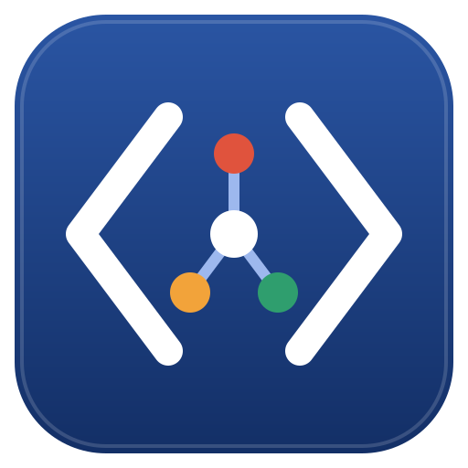

# Code mode skills



A direct MCP call puts its whole result in the context and costs one model turn. With `code-mode` one Python script
calls the same tools and **only what it prints comes back**. The idea comes from Cloudflare
([Code Mode](https://blog.cloudflare.com/code-mode/)) and Anthropic
([Code execution with MCP](https://www.anthropic.com/engineering/code-execution-with-mcp)); here it uses the servers
already declared on a computer, with nothing to host.

## Skills
<!-- generated:skills -->
| Skill | What it does | Installs with it |
|---|---|---|
| [`code-mode`](code-mode/SKILL.md) | Code mode for the local MCP servers: one Python script calls the tools and only what it prints enters the context (-50 to -90% tokens on batches, chains and big results). One engine without dependency, two entries picked by themselves (MCP tools `search` / `call` / `execute` / `job`, or a command line), background jobs, usage limits waited and partial failures resumed without redoing what succeeded, recipes kept like a cache, measured result sizes, profiles for Blender and Roblox Studio, hooks (reminder, compressor), optional OS sandbox; `/code-mode` for this session, `/code-mode setup` for a project, the whole computer or Claude Desktop. | [`interactive-questions`](../ai/interactive-questions/SKILL.md) |
<!-- /generated:skills -->

The *Installs with it* column comes from each `requires.txt`: `./setup.sh install <skill>` installs them too.

## What it saves
Opus 5.5 doing each task in Claude Code: tokens added to the context, and the cost.

| Task | Direct calls | Codemode MCP | Skill, command line |
|---|---:|---:|---:|
| media inventory, 20 files | 48,841, $0.70 | 8,161 (-83 %), $0.27 | 5,414 (-89 %), $0.29 |
| Kdenlive montage, 15 clips | 16,054, $0.49 | 10,940 (-32 %), $0.35 | 10,127 (-37 %), $0.44 |
| Godot scene, 10 nodes | 13,605, $0.42 | 4,566 (-66 %), $0.24 | 3,199 (-76 %), $0.27 |
| Blender, 30 objects | 6,716, $0.30 | 6,793 (+1 %), $0.30 | 3,988 (-41 %), $0.30 |

> [!NOTE]
> 4 tasks: -64 % tokens and -39 % cost through the MCP entry. Blender gains nothing: its `execute_blender_code` is
> already code mode. A single small call stays direct (it costs more through a script).

## How it works
One engine in Python (standard library only, Linux / macOS / Windows), two entries on it:

| Entry | Where | What it is |
|---|---|---|
| MCP tools `search`, `call`, `execute`, `job` | Claude Code and Claude Desktop, after `setup` | `codemode.py serve`: a stdio MCP server whose `instructions` carry the rules of use |
| command line `codemode.py search / call / run / job` | Claude Code, any agent with a shell, cron, CI | the same engine through a local daemon of the session (or `--standalone`) |

- The servers are the ones **already declared**: Claude Code (user, local, approved `.mcp.json`), Claude Desktop, and
  the ones `setup --move` took behind codemode. They start at first use and their tool list is kept in an index.
- The code runs in a **separate process** that only talks to the engine: it can be killed, it never sees the secrets
  of the servers, and it can be closed in an OS sandbox (bubblewrap, sandbox-exec) when the user turns it on.
- **One entry for short and long work**: `execute` answers when the script ends; after 40 s it goes on as a background
  job followed with `job`.
- **Failures in the middle**: a usage limit is waited and tried again, a batch stops sending when a server stays
  limited or goes down, what succeeded is kept, and the same `pmap(..., key=...)` run again only sends what is missing.
- **Recipes**: a script that worked is kept under a name, like a cache (unused 30 days or over the limits, the oldest
  go), found by `search` and run again without a model (`run --recipe name --standalone`).
- **Measured sizes**: the size of every result is learned; `search` shows `~1.3k tok` next to a tool, so the choice
  between a direct call and a script rests on numbers.
- **Profiles**: notes per kind of server, shown once per session by `search`. Shipped: Blender and Roblox Studio, whose
  `[code]` tools already run a script inside the application (the whole task in one script, a summary printed). Yours go
  in `<data>/profiles/*.md`.
- **Priority**: tokens by default (a subscription), or $ (an API key: fewer API calls). Asked at setup.
- **Hooks** (Claude Code): a reminder after 3 direct calls in a row on one server, and a compressor that replaces a
  direct result over ~2,500 tokens by a preview and the path of the full text (a smaller one handed over escaped twice
  comes back as its plain text: 5 to 25% fewer tokens).

## Where it works

| | Skill and command line | MCP tools |
|---|---|---|
| Claude Code (terminal, the Code tab of the desktop app) | yes | yes, after `/code-mode setup` |
| Claude Desktop (chat) | no shell there | yes, after `setup --desktop` (restart the app) |
| claude.ai (web, mobile) | no | no: it only reaches public remote servers, never the ones of a computer |

> [!IMPORTANT]
> Run on Linux only so far (Python 3.9 and 3.14): `python3 scripts/selftest.py` checks the engine on macOS or
> Windows in a minute.

## Usage
```bash
/code-mode                      # this session, nothing installed
/code-mode setup                # asks: where, priority (tokens by default), hooks, sandbox, which servers
/code-mode cout                 # this session: fewer API calls first ($, API key); /code-mode tokens to go back
/code-mode status | stats | doctor | off | uninstall
```
```bash
python3 scripts/codemode.py search "thumbnail" --server ffmpeg
python3 scripts/codemode.py run --write script.py
python3 scripts/codemode.py run --recipe thumbnails --args '{"dir": "/videos"}' --standalone
python3 scripts/selftest.py     # the engine against a fake server: both entries, the hook, the setup, the security rules
python3 scripts/bench.py        # direct calls against code mode on scripted tasks (sets: generic, blender, roblox)
```

## Config
`<data>/config.json` (`$CODEMODE_HOME`, default `~/.local/share/codemode`, `~/Library/Application Support/codemode`,
`%LOCALAPPDATA%\codemode`); only what differs from the defaults is written.

| Key | Default | Meaning |
|---|---|---|
| `priority` | `tokens` | `tokens` (subscription) or `cost` ($, API); `cost` sets `remind_after` 2, `compress_over_tokens` 6000 |
| `inline_wait_s` | 40 | a run still going after this continues as a job |
| `max_output_chars` | 12000 | a longer output goes to a file, its head and tail come back |
| `retry_attempts`, `retry_max_wait_s` | 3, 30 | tries on a usage limit; a longer wait is reported, not slept |
| `compress_over_tokens`, `remind_after` | 2500, 3 | thresholds of the two hooks |
| `recipes` | `ttl_days` 30, `max_count` 200, `max_bytes` 5 MB | the recipe cache |
| `rules` | `deny`, `read_only`, `write`: `[]` | patterns `server.tool` on top of read only by default |
| `sandbox`, `sandbox_hide`, `sandbox_writable` | off | the OS sandbox of the code and its extra paths |
| `sources`, `disabled_servers` | all on, none | where the servers are read from, which to ignore |

## Security
| Rule | Effect |
|---|---|
| read only by default | a tool that changes things needs `--write` / `allow_write`; `rules.deny` always wins |
| approved servers only | a `.mcp.json` server not approved in Claude Code is never started |
| local only | the engine listens on `127.0.0.1` with a private token |
| sandbox off | scripts run with the rights of the user |
| sandbox on | no network, writes only in the project, hidden files of the home out of sight |
| audit journal | every run in `<data>/audit/audit.jsonl`: code, tools, sizes |

[All the categories](../README.md) · [Installation](../../INSTALL.md)
