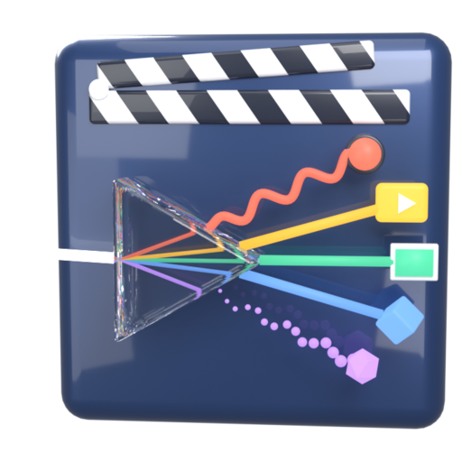
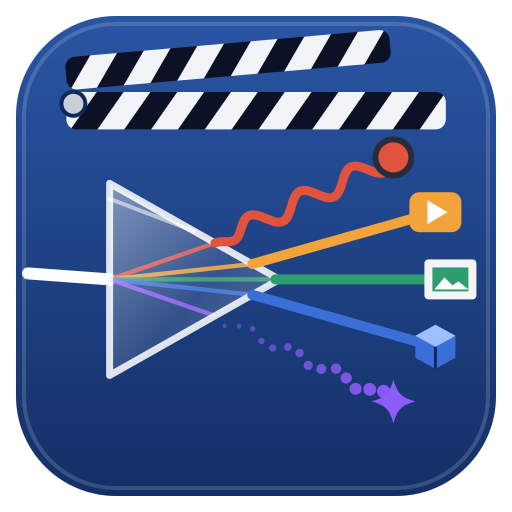
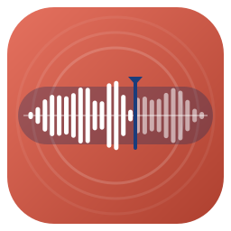
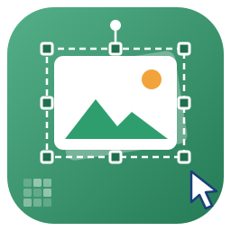
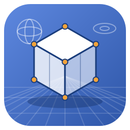

# Studio skills

Creative work with the tools of the computer: `setup-studio` scans what is installed for audio, image, video, 3D and
simulation / VFX / rendering (programs, flatpaks, Python packages, MCP servers, claude.ai connectors, GPU), fills the
gaps with free tools the user accepts, then **generates** the skills that use them. Those generated skills describe
one computer, so they live in `~/.claude/skills` (or as a claude.ai personal skill), never in this repository.

## Skills
<!-- generated:skills -->
| Skill | What it does | Installs with it |
|---|---|---|
| [`setup-studio`](setup-studio/SKILL.md) | Scans the creative tools of the computer (audio, image, video, 3D, simulation / VFX / rendering: programs, flatpaks, Python packages, MCP servers, claude.ai connectors, GPU), asks what to cover and whether the work is commercial, finds free tools without subscription for what is missing (license checked, MCP servers too) and installs the accepted ones, then generates a `/studio` router and one `studio-<domain>` skill per domain (which tool for each task, where, how, why, commands, licenses) in `~/.claude/skills` or as a claude.ai personal skill; run again to refresh. | [`interactive-questions`](../ai/interactive-questions/SKILL.md), [`clarify`](../ai/clarify/SKILL.md), [`ideation`](../ai/ideation/SKILL.md), [`memory-guard`](../system/memory-guard/SKILL.md), [`sliced-work`](../system/sliced-work/SKILL.md) |
<!-- /generated:skills -->

The *Installs with it* column comes from each `requires.txt`: `./setup.sh install <skill>` installs them too.

## What it generates

| | Skill | For |
|---|---|---|
|  | `/studio` | router: reads a creative request and loads the domain skills it touches |
|  | `studio-audio` | music, sound effects, voice, transcription, stems |
|  | `studio-image` | retouching, painting, vector, photo, batch, web compression, generation, upscaling |
|  | `studio-video` | editing, command-line cuts and encodes, compositing, motion graphics, subtitles, generation |
|  | `studio-3d` | modeling, CAD, mesh processing, materials, low-poly, image-to-3D, real-time |
|  | `studio-vfx` | fluids / smoke / cloth / particles, rendering, compositing, CFD, physics from code |

The logo (a glass prism splitting a ray into the five domains, under a clapper) and the icons are in
[`setup-studio/assets/`](setup-studio/assets): `logo.svg` (flat), `logo.png`, `logo-3d.png` (rendered in Blender),
`icons/<domain>.svg` / `.png`; `setup-studio` copies them into the skills it generates.

Each one has a *Which tool for what* table (the installed tool chosen per task and why), how to drive each tool (MCP
server, command line headless, GUI), ready commands, license and **commercial use** of each tool, and what is still
missing with the free tool to install. The catalog behind it (`setup-studio/reference/catalog.json`) lists ~70 free
tools with their license, install commands and MCP servers.

## Examples
- */setup-studio* (first run: scan, questions, installs, generation; later runs: refresh)
- */studio add music under this video, ducked under the voice, and French subtitles*
- */studio a parametric box for 3D printing, 80 x 60 x 40 mm*
- *render the animation of scene.blend on the GPU*

[All the categories](../README.md) · [Installation](../../INSTALL.md)
